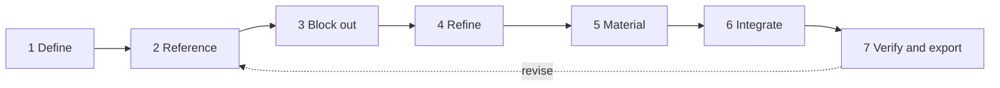

# Process framework: building an anatomical 3D object

A repeatable workflow for adding or refining a structure in this model (for example, a digestive organ). It extends the seven-stage pipeline that used to sit in the page's "Animation pipeline" panel, and ties each stage to the code in `index.html`.

## Stage 1. Define the scope

Decide what the object is and who it is for before writing any geometry.

- **Structure and purpose**: which organ or region, and what the viewer should learn (shape, position, layers, relations to neighbours).
- **Level of detail**: whole organ only, or its regions and wall layers (as the stomach is modelled: cardia, fundus, body, antrum, rugae, three muscle layers, serosa).
- **Deliverable**: a named group inside a system (e.g. `digestive`) that can be toggled and exported.

Output: a one-paragraph brief and a parts list. The parts list becomes the `parts: [...]` entry for the system in the `SYS` array, so the UI and the model stay in step.

## Stage 2. Gather references

- Collect atlas plates and textbook figures. Keep them in a separate `references/` folder and out of the build (the `uploads/` images from the original zip are 24 MB, so they are not committed).
- Record real proportions: lengths, diameters, and landmarks relative to vertebral levels, ribs and the pelvis.
- Note relations: what lies in front of, behind, above and below the structure, and which structures it touches or attaches to.

Output: a table of dimensions and landmarks (in metres, y-up) used in stage 3.

## Stage 3. Block out (primitive geometry)

Place coarse forms at the correct position and scale before any detail.

1. Use the model's coordinate frame: metres, y-up, anatomical position, figure's own left/right, origin at the midline.
2. Build with the existing helpers (`sph`, `box`, `cap`, `seg`, `tube`) or a lathe/spline for hollow organs.
3. Register every mesh with `reg(system, name, mesh, { label })`. The `name` becomes the OBJ/GLB object name and the `label` becomes the hover text.
4. Check against the planes tool (sagittal, coronal, transverse) and against neighbouring systems with Skin and Skeletal switched on.

Output: a blocked-out group that is correctly placed and proportioned, even if it looks crude.

## Stage 4. Refine the form

Replace primitives with anatomically shaped geometry, in this order of preference:

- **Variable-radius tubes** along a centreline for ducts, the oesophagus, and the intestines (constrictions, rugae, plicae circulares, haustra).
- **Lathe or extruded profiles** for organs with a clear cross-section.
- **Sculpted displacement** only for fine surface detail that tubes cannot give.

Keep a single centreline (`CatmullRomCurve3`) per tubular organ. It can later drive anything that follows the lumen, such as labels, cut-away views or future animation.

Output: geometry that reads correctly from at least front, side and a three-quarter view.

## Stage 5. Materials and colour

- Reuse the shared `mat` table. Add a new named `MeshStandardMaterial` only when no existing one fits.
- Use flat colours and opacity; avoid image textures so OBJ and GLB exports stay intact.
- Make walls translucent where the lumen should be visible, and set `depthWrite: false` on transparent materials.
- Keep roughness moderate and metalness at 0 (the stage has no environment map).

Output: every mesh has a named material; the system swatch colour in `SYS` matches the dominant material.

## Stage 6. Integrate into the page

- Add the group to the right system group (`G[sys]`) through `reg`.
- Update the system's `blurb` and `parts` text so the information panel is accurate.
- Confirm hover labels, the "Show only this system" button, the Skin opacity slider and the plane sliders all still behave.

Output: the object is selectable, labelled, and toggles with its system.

## Stage 7. Verify and export

Checklist before committing:

- [ ] Page loads with no console errors.
- [ ] Proportions and position match the stage 2 reference table.
- [ ] No z-fighting or clipping with neighbouring organs; transparent parts sort correctly.
- [ ] Hover shows the right label on every part.
- [ ] OBJ + MTL and GLB downloads open in an external viewer with names and colours intact.
- [ ] `PROCESS.md` and the `parts` list are updated if the scope changed.

Revise from stage 2 whenever verification shows a mismatch with the references.

## Conventions

| Item | Convention |
| --- | --- |
| Units | metres, y-up, anatomical position |
| Left/right | the figure's own |
| Mesh names | `snake_case`, with `_left` / `_right` suffix for paired structures |
| Labels | `userData.label`, shown on hover |
| Systems | one `THREE.Group` per system, named `<system>_system` |
| Commits | one structure or one refinement stage per commit |
